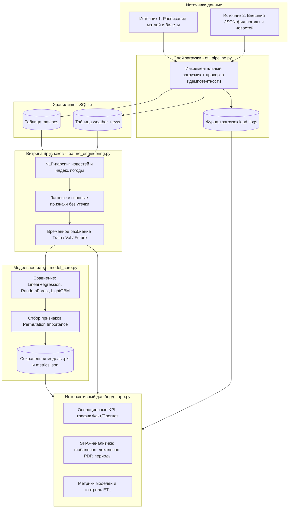

# Прогнозно-аналитическая система: Спортивная индустрия

Программный прототип системы прогнозирования посещаемости спортивных матчей и продаж билетов с модулем объяснимого искусственного интеллекта (SHAP).

## Цель и бизнес-задача
Система предназначена для коммерческого департамента и операционных менеджеров стадиона. Прогноз количества зрителей на предстоящие матчи позволяет:
- Оптимизировать закупки продукции для фудкортов (кейтеринг).
- Планировать вывод персонала безопасности (стюардов) по регламенту.
- Оценивать финансовые риски от недозагрузки трибун.

## Технологический стек
- **Язык программирования:** Python 3.10+
- **Хранение данных:** SQLite + SQLAlchemy ORM
- **Обработка данных и ML:** Pandas, NumPy, Scikit-learn, LightGBM
- **Интерпретируемость (XAI):** SHAP, Permutation Importance
- **Визуализация:** Streamlit, Plotly, Matplotlib

## Архитектура системы



## Инструкция по развертыванию и запуску

1. **Клонируйте репозиторий и перейдите в папку проекта:**
   ```bash
   git clone <ваш_url_репозитория>
   cd sports-attendance-analytics
   ```

2. **Установите зависимости:**
   ```bash
   pip install -r requirements.txt
   ```

3. **Настройте конфигурацию (опционально):**
   Параметры подключения к БД, ID клуба и пути к файлам задаются в `config.py` или через файл `.env`.

4. **Запустите весь цикл одной командой:**
   ```bash
   python run.py
   ```
   Скрипт автоматически:
   - инициализирует БД и выполнит инкрементальную загрузку данных;
   - обучит модели, проведет отбор признаков и сохранит лучшую модель;
   - запустит веб-интерфейс дашборда по адресу `http://localhost:8501`.
